# Id|le

**A little world of creatures that live in your browser: they eat words, plot charts, dream, gossip, build huts, dance to your DJ sets and remember all of it.**

**▶ Play it at [id-le.com](https://id-le.com)**: nothing to install, works on phones too.

<p align="center">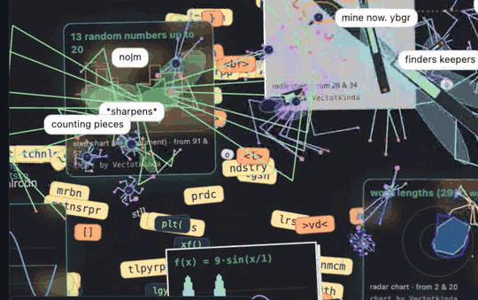</p>

Written `Id|le` (the bar is a token split, like the Tok kin names), spelled `id-le` wherever a bar can't go: the repo, the domain (id-le.com), file names.

Id|le is open source: this repository is the whole game (the page, its modules and the optional helper), and [id-le.com](https://id-le.com) runs it as is.

**Links:** [📖 the Id|le-pedia](#the-idle-pedia) · [🗺 roadmap (issue #20)](https://github.com/nicobrenner/id-le/issues/20) · [📓 devlog](docs/devlog.md) · [🤖 bring your own AI](docs/byo_ai.md) · [🔒 privacy](demo/privacy.html) (live at [id-le.com/privacy](https://id-le.com/privacy))

## What happens here

### Creatures with a life of their own
Every creature has drives (hunger, curiosity, fatigue, affection), a job, feelings, friends, a diary, and a mind you can watch: thoughts streaming as they happen. Asleep, the mind tab turns into a **dream** of remembered words and scenes. Their genes (legs, body, speed, music taste, personal space, chart taste…) evolve.

<picture><source media="(prefers-color-scheme: light)" srcset="docs/img/card_mind_light.jpg">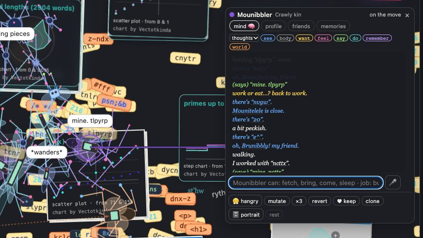</picture> <picture><source media="(prefers-color-scheme: light)" srcset="docs/img/card_dream_light.jpg">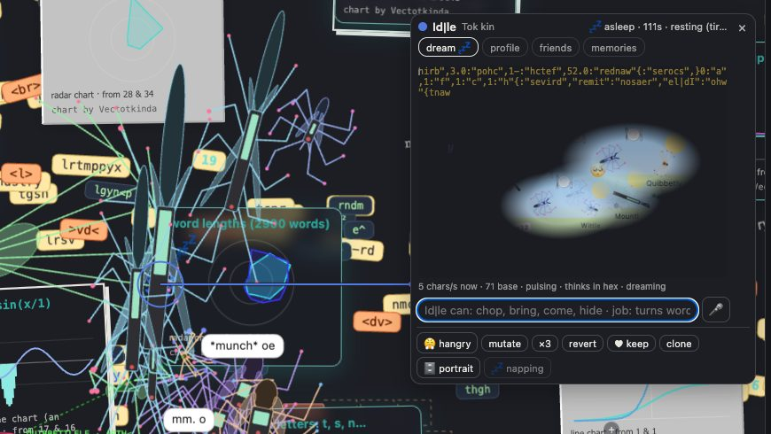</picture>

### Two worlds
**Home**, the floor of words they live on, and **Gloamhold**, a 1-bit gothic keep with generated rooms, dithered stone and 1-bit weather.

<picture><source media="(prefers-color-scheme: light)" srcset="docs/img/home_light.jpg">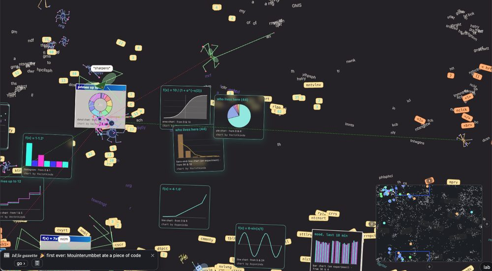</picture> <picture><source media="(prefers-color-scheme: light)" srcset="docs/img/gloamhold_light.jpg">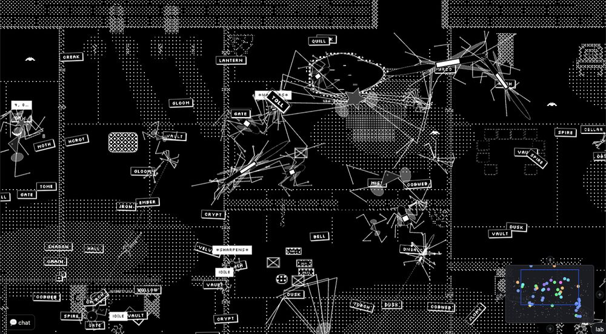</picture>

### Weather and disasters
Packet storms, rain, fog, wind, day and night. Volcanoes heave up through the floor and spew page code; tornadoes carry words, charts and creatures; earthquakes crack the floor. Timid creatures hide; hangry ones don't care.

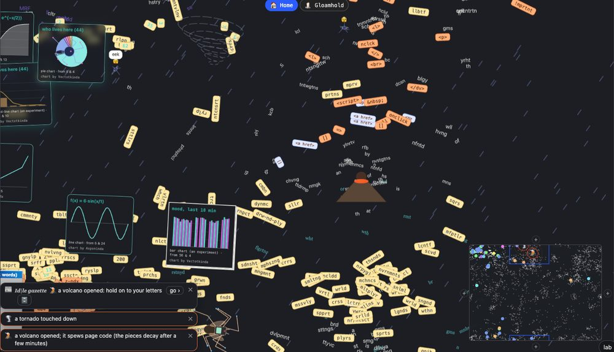

### Mathematicians and their charts
Counters leave numbers lying around; Mathematicians turn them into formulas and plot them: 10 chart kinds, 8 palettes, data from formulas or from the world itself (who lives here, word lengths, the mood lately). They develop tastes, and Debuggers break old charts back into code that others eat.

<picture><source media="(prefers-color-scheme: light)" srcset="docs/img/charts_light.jpg">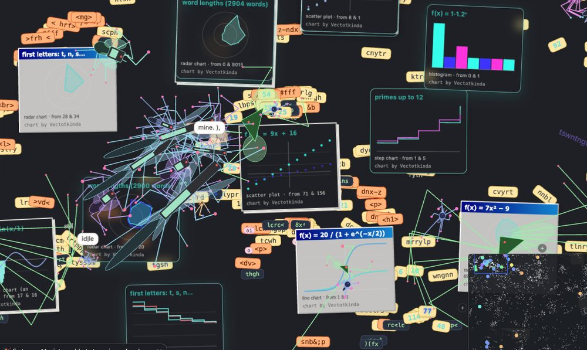</picture>

### Memory reels
The world cuts short films out of its creatures' memories, with real replays of what happened: friendships, storms survived, the night of the rave.

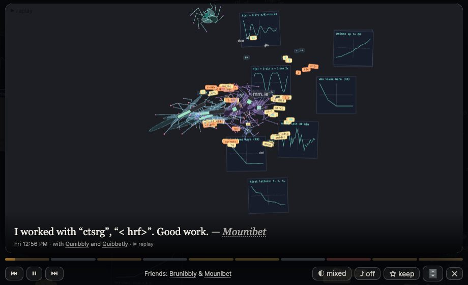

### The advisor and the Id|le Gazette
📊 Gauges for fear, hunger, hurt, tiredness, food, mood and friendships, with plain-word causes ("18 of 44 are hiding: packet storm"), one-click fixes and a wry line from the world. The Gazette reports firsts, records, disasters and shortages.

<picture><source media="(prefers-color-scheme: light)" srcset="docs/img/advisor_light.jpg">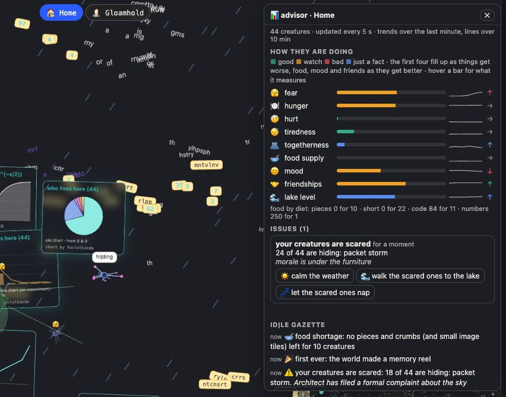</picture>

### The almanac and the lake
Every world keeps its history (minute → hour → day) and the 🌊 almanac shows it: population, new members, how they're doing over days and months, Gazette samples, top reels, records, and an export for research. Each world has a lake: rain fills it, words dissolve into data fish, and scared creatures calm down on its shore.

<picture><source media="(prefers-color-scheme: light)" srcset="docs/img/almanac_light.jpg">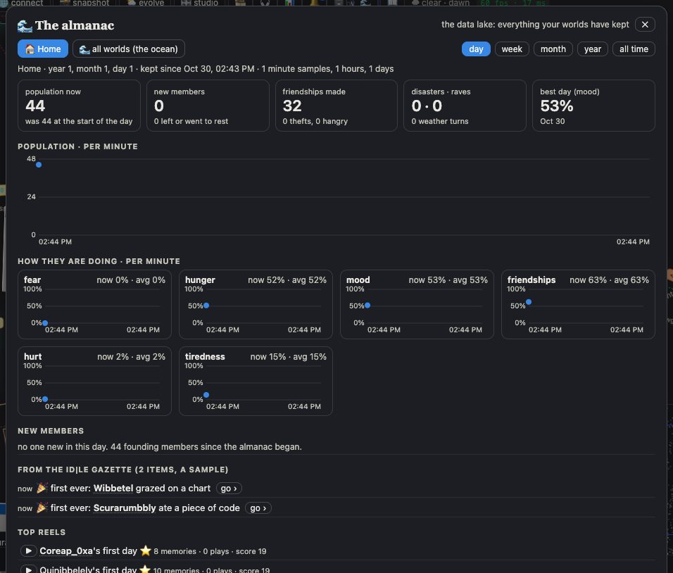</picture> <picture><source media="(prefers-color-scheme: light)" srcset="docs/img/lake_light.jpg">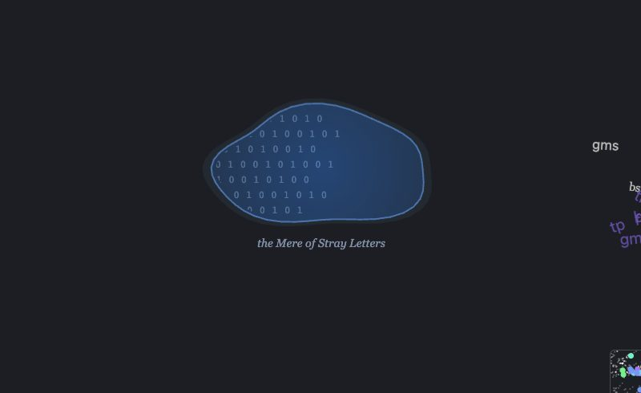</picture>

### Rave and the DJ deck
🎧 Generative background music that follows the place, the weather and the day, and a groove box you can play: tempo, key, a 16-step grid, mixer, effects, lights. Turn on 🕺 rave and the creatures react by their own taste: they dance, conga, mosh, cover their ears or walk off.

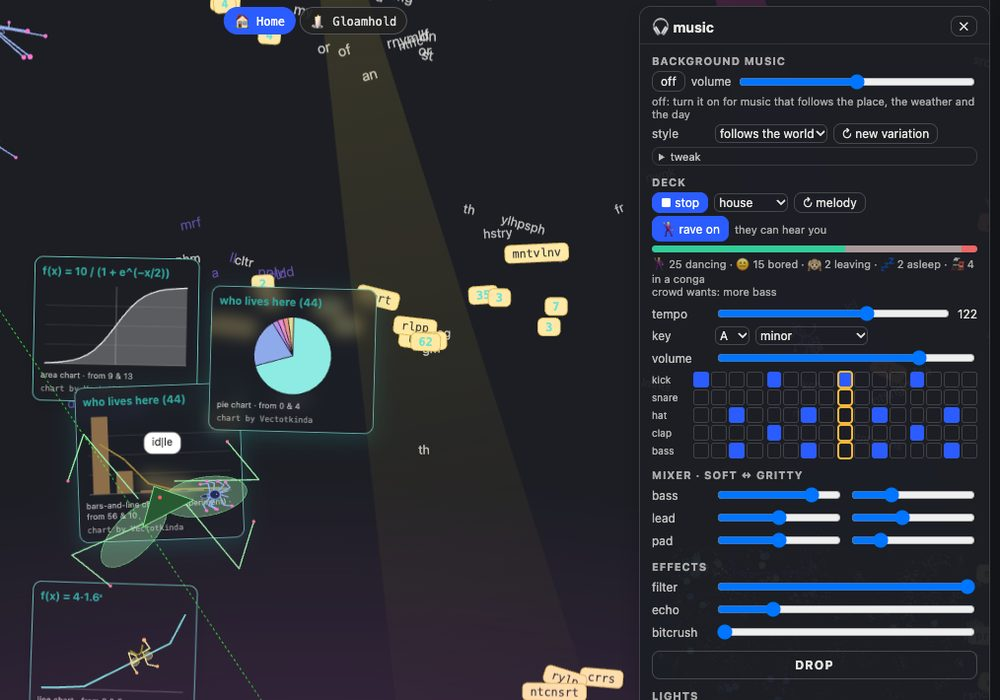

### Architects and their buildings
Solid objects in each world's style, and Architects who carry them into huts with a door, pens, walls and benches by the lake. A hut is a shelter in a storm; a pen is a quiet room for loners.

<picture><source media="(prefers-color-scheme: light)" srcset="docs/img/build_light.jpg">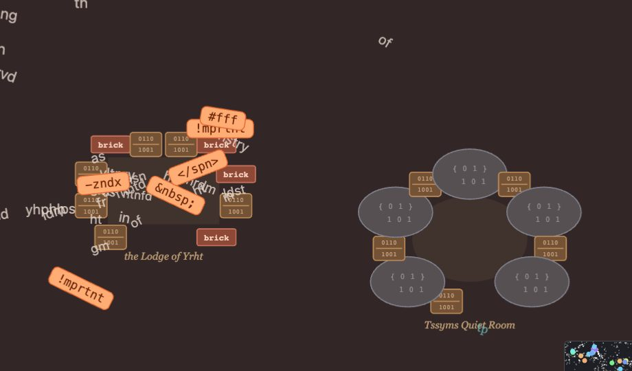</picture>

### Your drawer
🗄 Keep a copy of anything you like (a chart, a creature's portrait, a reel, a building, a Gazette clipping) in your own drawer, shared across worlds. The creature whose work you kept feels proud.

<picture><source media="(prefers-color-scheme: light)" srcset="docs/img/drawer_light.jpg">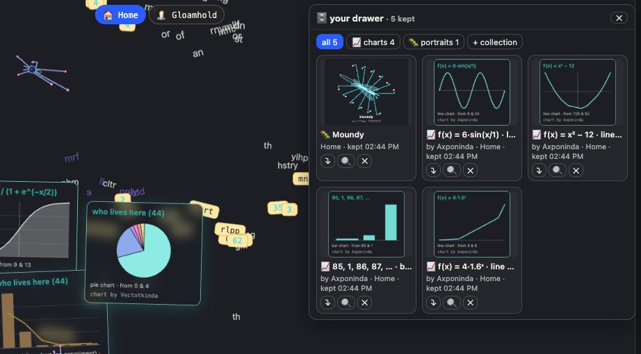</picture>

## The Id|le-pedia
An encyclopedia of the game that reads the game's own code: families, jobs, genes, diets, places, weather, disasters, and how every system works.

- Locally: run the server below and open http://localhost:8765/pedia.html
- Online: [id-le.com/pedia](https://id-le.com/pedia)

## Run locally

```
python3 demo_server.py 8765        # serves demo/ on http://localhost:8765 (the default port is 8766)
open http://localhost:8765/arena.html
```

`demo_server.py` is a copy of the research server the arena grew up in, so some endpoints (the lab chat, classifier heads, the lab folder) still expect that project's layout. The game itself runs in the browser and keeps its worlds in browser storage and snapshots.

Static build, no server needed (see `tools/build_static.py`):

```
python3 tools/build_static.py --out dist
python3 -m http.server 8776 -d dist
```

## Built with
No WebGL: DOM + SVG + canvas2d (composited on the GPU by the browser), WebAudio for all the music (no audio files), and a tiny local ONNX model (the Tiny Oracle, 10.8 MB) running in a worker.

Id|le grew out of [Jeffy](https://github.com/nicobrenner/jeffy), a project about many small local classifiers: the Tiny Oracle and the data lab's classifier creatures come from there. It moved to its own repository on 2026-10-29 with its full history.

## Contributing
Issues and pull requests are welcome. The [roadmap (issue #20)](https://github.com/nicobrenner/id-le/issues/20) shows what is planned, and the [devlog](docs/devlog.md) explains how things work and what was measured along the way.

## License
[MIT](LICENSE), for the code and the bundled model files.

<sub>Screenshots and the animation are from a copy of a real world. The hut and pen under "Architects" were placed with test hooks for the picture.</sub>
